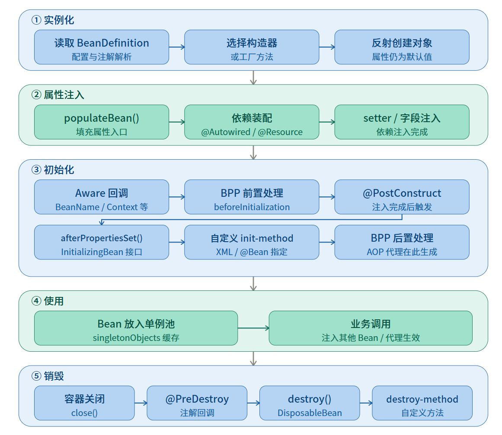

## Bean的生命周期

**Bean的生命周期**：`实例化` → `属性注入` → `初始化` → `使用` → `销毁` 。


### 源码

在AutowireCapableBeanFactory接口中可以看见完整的Bean的生命周期，这里贴上核心接口：

```java

public interface AutowireCapableBeanFactory extends BeanFactory {

    /**
     * Fully create a new bean instance of the given class.
     */
    <T> T createBean(Class<T> beanClass) throws BeansException;

    /**
     * Populate the given bean instance through applying after-instantiation callbacks
     */
    void autowireBean(Object existingBean) throws BeansException;

    /**
     * 配置Bean，比如：调用Aware接口
     */
    Object configureBean(Object existingBean, String beanName) throws BeansException;


    //-------------------------------------------------------------------------
    // Specialized methods for fine-grained control over the bean lifecycle
    //-------------------------------------------------------------------------

    /**
     * 创建实例化
     */
    Object createBean(Class<?> beanClass, int autowireMode, boolean dependencyCheck) throws BeansException;

    /**
     * 自动状态
     */
    Object autowire(Class<?> beanClass, int autowireMode, boolean dependencyCheck) throws BeansException;

    /**
     * 自动状态
     */
    void autowireBeanProperties(Object existingBean, int autowireMode, boolean dependencyCheck)
            throws BeansException;

    /**
     * 属性填充
     */
    void applyBeanPropertyValues(Object existingBean, String beanName) throws BeansException;

    /**
     * 初始化
     */
    Object initializeBean(Object existingBean, String beanName) throws BeansException;

    /**
     * BPP前置
     */
    Object applyBeanPostProcessorsBeforeInitialization(Object existingBean, String beanName)
            throws BeansException;

    /**
     * BPP后置
     */
    Object applyBeanPostProcessorsAfterInitialization(Object existingBean, String beanName)
            throws BeansException;

    /**
     * 销毁
     */
    void destroyBean(Object existingBean);

}

```

## 实例化

### Bean的解析与注册

容器启动的第一步，不是直接创建Bean，而是解析并注册Bean的元数据定义。`BeanDefinition`
是Bean的元数据载体，相当于Bean的“出生证明”，包含了Bean的全量信息：全类名、作用域、是否懒加载、依赖关系、初始化方法、销毁方法等。Spring容器完全基于这个元数据来创建Bean实例。

执行流程：

- 容器启动时，扫描@Component、@Service、@Controller、@Bean等注解标注的类/方法，解析生成对应的BeanDefinition；
- 将所有BeanDefinition注册到BeanDefinitionRegistry（Bean定义注册中心）；
- 执行所有BeanFactoryPostProcessor实现类，允许开发者在Bean实例化之前，修改、新增、删除BeanDefinition

#### 自定义BeanFactoryPostProcessor实现类

通过实现BeanFactoryPostProcessor来控制Bean的示例。
指定Bean：

```java
package com.tothefor.study.beans;


import org.springframework.stereotype.Component;


@Component
public class User {


    public User() {
        System.out.println("User无参构造执行...");
    }


    public void initImpl() {
        System.out.println("BeanFactoryPostProcessor的 initMethod方法执行");
    }


    public void destroyMethodImpl() {
        System.out.println("BeanFactoryPostProcessor的 destroyMethod方法执行");
    }

}

```

实现类：

```java
package com.tothefor.study.beans;

import lombok.extern.slf4j.Slf4j;
import org.springframework.beans.BeansException;
import org.springframework.beans.factory.config.BeanDefinition;
import org.springframework.beans.factory.config.BeanFactoryPostProcessor;
import org.springframework.beans.factory.config.ConfigurableListableBeanFactory;
import org.springframework.stereotype.Component;


@Component
public class BeanFactoryPostProcessorImpl implements BeanFactoryPostProcessor {

    @Override
    public void postProcessBeanFactory(ConfigurableListableBeanFactory beanFactory) throws BeansException {
        System.out.println("【BeanFactoryPostProcessor】执行开始，容器中已注册的BeanDefinition数量：" + beanFactory.getBeanDefinitionCount());
        // 获取指定Bean的定义信息
        String beanName = "user";
        if (beanFactory.containsBeanDefinition(beanName)) {
            BeanDefinition beanDefinition = beanFactory.getBeanDefinition(beanName);
            // 指定Bean的初始化方法
            beanDefinition.setInitMethodName("initImpl");
            // 指定Bean的销毁方法
            beanDefinition.setDestroyMethodName("destroyMethodImpl");
        }
        System.out.println("【BeanFactoryPostProcessor】执行结束");
    }
}

```

输出：

```bash
【BeanFactoryPostProcessor】执行开始，容器中已注册的BeanDefinition数量：134
【BeanFactoryPostProcessor】执行结束
User无参构造执行...
BeanFactoryPostProcessor的 initMethod方法执行
BeanFactoryPostProcessor的 destroyMethod方法执行
```

#### 补充

如果在BeanFactoryPostProcessor的实现类中指定了Bean的init和destroy方法，那么原本Bean的init和destroy方法就会被覆盖。

Bean：

```java
package com.tothefor.study.beans;


import org.springframework.beans.factory.DisposableBean;
import org.springframework.beans.factory.InitializingBean;

import javax.annotation.PostConstruct;
import javax.annotation.PreDestroy;

public class User implements InitializingBean, DisposableBean {


    public User() {
        System.out.println("User无参构造执行...");
    }

    // 初始化方法，对应initMethod
    public void init() {
        System.out.println("配置Bean initMethod方法执行");
    }

    public void initImpl() {
        System.out.println("BeanFactoryPostProcessor的 initMethod方法执行");
    }

    // 销毁方法，对应destroyMethod
    public void destroyMethod() {
        System.out.println("配置Bean destroyMethod方法执行");
    }

    public void destroyMethodImpl() {
        System.out.println("BeanFactoryPostProcessor的 destroyMethod方法执行");
    }

    @PostConstruct
    public void initPostConstruct() {
        System.out.println("注解方式 initMethod方法执行");
    }

    // 容器销毁前执行销毁操作
    @PreDestroy
    public void destroyPreDestroy() {
        System.out.println("注解方式 destroyMethod方法执行");
    }


    @Override
    public void afterPropertiesSet() throws Exception {
        System.out.println("接口方式 initMethod方法执行");
    }

    @Override
    public void destroy() throws Exception {
        System.out.println("接口方式 destroyMethod方法执行");

    }
}

```

Bean的配置类：

```java
package com.tothefor.study.beans;


import org.springframework.context.annotation.Bean;
import org.springframework.context.annotation.Configuration;

@Configuration
public class BeanConfig {

    // 手动注册Bean，并指定初始化和销毁方法
    @Bean(initMethod = "init", destroyMethod = "destroyMethod")
    public User user() {
        return new User();
    }

}

```

输出：

```bash
【BeanFactoryPostProcessor】执行开始，容器中已注册的BeanDefinition数量：135
【BeanFactoryPostProcessor】执行结束
User无参构造执行...
注解方式 initMethod方法执行
接口方式 initMethod方法执行
BeanFactoryPostProcessor的 initMethod方法执行
注解方式 destroyMethod方法执行
接口方式 destroyMethod方法执行
BeanFactoryPostProcessor的 destroyMethod方法执行
```

可以看到，原本通过Bean的配置类指定的init和destroy方法是没有输出的。

#### Bean实例化

> AbstractAutowireCapableBeanFactory#createBean → doCreateBean → createBeanInstance

## 属性填充

> AbstractAutowireCapableBeanFactory#populateBean

实例化完成后，容器进入属性填充阶段，也就是我们常说的依赖注入（DI）。就是 populateBean。它的职责是：遍历 BeanDefinition 中的
propertyValues，或依据自动装配规则，把该 Bean
依赖的其他 Bean 注入到对应字段或 setter 方法中。

- 解析Bean中所有标注了@Autowired、@Value、@Resource等注解的属性/setter方法；
- 从容器中查找匹配的依赖Bean，若依赖Bean未创建，会先触发依赖Bean的完整生命周期（递归）

## 初始化

### 源码

抽象类AbstractAutowireCapableBeanFactory中的initializeBean源码：

```java
protected Object initializeBean(String beanName, Object bean, @Nullable RootBeanDefinition mbd) {

    // 1. 调用 Aware 接口
    if (System.getSecurityManager() != null) {
        AccessController.doPrivileged((PrivilegedAction<Object>) () -> {
            invokeAwareMethods(beanName, bean);
            return null;
        }, getAccessControlContext());
    } else {
        invokeAwareMethods(beanName, bean);
    }

    // 2. 初始化前的 BeanPostProcessor
    Object wrappedBean = bean;
    if (mbd == null || !mbd.isSynthetic()) {
        wrappedBean = applyBeanPostProcessorsBeforeInitialization(wrappedBean, beanName);
    }

    // 3. 调用初始化方法
    try {
        invokeInitMethods(beanName, wrappedBean, mbd);
    } catch (Throwable ex) {
        throw new BeanCreationException(
                (mbd != null ? mbd.getResourceDescription() : null),
                beanName, "Invocation of init method failed", ex);
    }

    // 4. 初始化后的 BeanPostProcessor
    if (mbd == null || !mbd.isSynthetic()) {
        wrappedBean = applyBeanPostProcessorsAfterInitialization(wrappedBean, beanName);
    }

    return wrappedBean;
}
```

### Aware接口回调

Aware接口是Spring提供的容器资源注入通道，让Bean能够感知到自身在容器中的信息，以及获取容器的底层核心组件。属性填充完成后，容器会检查当前Bean是否实现了Aware系列接口，若实现了，会按固定顺序回调对应的接口方法，将Spring容器的底层组件注入到Bean中。

Aware接口以及执行的先后顺序：

- `BeanNameAware`：注入当前Bean在容器中的名称；
- `BeanClassLoaderAware`：注入加载当前Bean的ClassLoader；
- `BeanFactoryAware`：注入当前的BeanFactory实例；
- `EnvironmentAware`：注入Environment环境配置对象；
- `EmbeddedValueResolverAware`：注入占位符解析器，用于解析`${}`配置 ；
- `ResourceLoaderAware`：注入资源加载器（仅ApplicationContext环境生效） ；
- `ApplicationEventPublisherAware`：注入事件发布器 ；
- `MessageSourceAware`：注入国际化消息源；
- `ApplicationContextAware`：注入ApplicationContext应用上下文对象；

示例：

```java
package com.tothefor.study.beans;


import org.springframework.beans.BeansException;
import org.springframework.beans.factory.BeanClassLoaderAware;
import org.springframework.beans.factory.BeanFactory;
import org.springframework.beans.factory.BeanFactoryAware;
import org.springframework.beans.factory.BeanNameAware;
import org.springframework.context.*;
import org.springframework.core.env.Environment;
import org.springframework.core.io.ResourceLoader;
import org.springframework.stereotype.Component;
import org.springframework.util.StringValueResolver;

@Component
public class AwareDemo implements BeanNameAware, BeanClassLoaderAware, BeanFactoryAware, EnvironmentAware, EmbeddedValueResolverAware, ResourceLoaderAware, ApplicationEventPublisherAware, MessageSourceAware, ApplicationContextAware {

    @Override
    public void setBeanName(String name) {
        System.out.println("BeanNameAware 执行 " + name);
    }

    @Override
    public void setBeanClassLoader(ClassLoader classLoader) {
        System.out.println("BeanClassLoaderAware 执行 ");
    }

    @Override
    public void setBeanFactory(BeanFactory beanFactory) throws BeansException {
        System.out.println("BeanFactoryAware 执行 ");

    }

    @Override
    public void setEnvironment(Environment environment) {
        System.out.println("EnvironmentAware 执行 ");
    }

    @Override
    public void setEmbeddedValueResolver(StringValueResolver resolver) {
        System.out.println("EmbeddedValueResolverAware 执行 ");

    }

    @Override
    public void setResourceLoader(ResourceLoader resourceLoader) {
        System.out.println("ResourceLoaderAware 执行 ");

    }

    @Override
    public void setApplicationEventPublisher(ApplicationEventPublisher applicationEventPublisher) {
        System.out.println("ApplicationEventPublisherAware 执行 ");

    }

    @Override
    public void setMessageSource(MessageSource messageSource) {
        System.out.println("MessageSourceAware 执行 ");
    }

    @Override
    public void setApplicationContext(ApplicationContext applicationContext) throws BeansException {
        System.out.println("ApplicationContextAware 执行 ");

    }

}

```

输出：

```bash
BeanNameAware 执行 awareDemo
BeanClassLoaderAware 执行 
BeanFactoryAware 执行 
EnvironmentAware 执行 
EmbeddedValueResolverAware 执行 
ResourceLoaderAware 执行 
ApplicationEventPublisherAware 执行 
MessageSourceAware 执行 
ApplicationContextAware 执行
```

### BeanPostProcessor

BeanPostProcessor 是 Spring 中最重要的扩展接口之一，它提供两个方法：`postProcessBeforeInitialization`和
`postProcessAfterInitialization`。

- BPP前置：
  Aware接口回调完成后，容器会执行所有BeanPostProcessor实现类的postProcessBeforeInitialization方法，也就是初始化前置处理，在Bean初始化之前执行，允许开发者对Bean实例进行修改、包装、替换。

- BPP后置：
  初始化操作完成后，容器会执行所有BeanPostProcessor实现类的postProcessAfterInitialization方法，也就是初始化后置处理，在Bean初始化完成后，对Bean进行最终的修改、包装、替换，Spring
  AOP的动态代理对象，就是在这个阶段生成的。

> 如果Bean被AOP切面拦截，在后置处理阶段，会返回一个动态代理对象替换原始的目标对象，最终存入单例池的是代理对象，而非原始对象，这也是AOP能够实现功能增强的底层原理。

实现：

```java
package com.tothefor.study.beans;

import org.springframework.beans.BeansException;
import org.springframework.beans.factory.config.BeanPostProcessor;
import org.springframework.stereotype.Component;


@Component
public class BeanPostProcessorImpl implements BeanPostProcessor {

    @Override
    public Object postProcessBeforeInitialization(Object bean, String beanName) throws BeansException {
        System.out.println("BeanPostProcessor before执行 beanName=" + beanName);
        return bean;
    }

    @Override
    public Object postProcessAfterInitialization(Object bean, String beanName) throws BeansException {
        System.out.println("BeanPostProcessor after执行 beanName=" + beanName);
        return bean;
    }
}

```

输出结果会非常多，这里只粘贴了相关的输出：

```bash
【BeanFactoryPostProcessor】执行开始，容器中已注册的BeanDefinition数量：136
【BeanFactoryPostProcessor】执行结束
User无参构造执行...
BeanPostProcessor before执行 beanName=user
注解方式 initMethod方法执行
接口方式 initMethod方法执行
BeanFactoryPostProcessor的 initMethod方法执行
BeanPostProcessor after执行 beanName=user
注解方式 destroyMethod方法执行
接口方式 destroyMethod方法执行
BeanFactoryPostProcessor的 destroyMethod方法执行
```

#### 示例

基于BeanPostProcessor实现全局接口日志切面，替代传统AOP，实现所有Controller接口的入参、出参、响应时间全量日志打印，性能更优，扩展更灵活。

```java
package com.tothefor.study.beans;


import com.alibaba.fastjson2.JSON;
import lombok.extern.slf4j.Slf4j;
import org.springframework.beans.BeansException;
import org.springframework.beans.factory.config.BeanPostProcessor;
import org.springframework.cglib.proxy.Enhancer;
import org.springframework.cglib.proxy.MethodInterceptor;
import org.springframework.stereotype.Component;
import org.springframework.web.bind.annotation.RestController;

@Slf4j
@Component
public class ControllerLogPostProcessor implements BeanPostProcessor {
    @Override
    public Object postProcessAfterInitialization(Object bean, String beanName) throws BeansException {
        // 仅处理标注了@RestController的Bean
        if (bean.getClass().isAnnotationPresent(RestController.class)) {
            log.info("【日志增强】为Controller[{}]创建CGLIB代理对象", beanName);
            // CGLIB 通过继承目标类生成代理子类，代理类保留 @RestController / @GetMapping 注解
            Enhancer enhancer = new Enhancer();
            enhancer.setSuperclass(bean.getClass());
            enhancer.setCallback((MethodInterceptor) (obj, method, args, proxy) -> {
                // Object 的 toString/equals/hashCode 等方法不做增强，避免干扰
                if (method.getDeclaringClass() == Object.class) {
                    return proxy.invokeSuper(obj, args);
                }
                long startTime = System.currentTimeMillis();
                String className = bean.getClass().getSimpleName();
                String methodName = method.getName();
                // 打印入参
                log.info("【接口请求】{}.{} 入参：{}", className, methodName, JSON.toJSONString(args));
                Object result;
                try {
                    // 调用父类（即原始 Controller）的真实方法
                    result = proxy.invokeSuper(obj, args);
                    // 打印出参
                    log.info("【接口响应】{}.{} 出参：{}", className, methodName, JSON.toJSONString(result));
                } catch (Throwable e) {
                    log.error("【接口异常】{}.{} 执行异常", className, methodName, e);
                    throw e;
                } finally {
                    // 打印响应时间
                    long endTime = System.currentTimeMillis();
                    log.info("【接口耗时】{}.{} 执行耗时：{}ms", className, methodName, (endTime - startTime));
                }
                return result;
            });
            return enhancer.create();
        }
        return bean;
    }
}

```

在启动服务后，控制台上会先打印日志：

```bash
 【日志增强】为Controller[demo]创建CGLIB代理对象
```

访问访问对应接口后，日志如下：

```bash
2026-11-23 11:06:35.419  INFO 37604 --- [nio-8080-exec-1] c.t.s.beans.ControllerLogPostProcessor   : 【接口请求】Demo.test 入参：[]
测试接口
2026-11-23 11:06:35.424  INFO 37604 --- [nio-8080-exec-1] c.t.s.beans.ControllerLogPostProcessor   : 【接口响应】Demo.test 出参：null
2026-11-23 11:06:35.424  INFO 37604 --- [nio-8080-exec-1] c.t.s.beans.ControllerLogPostProcessor   : 【接口耗时】Demo.test 执行耗时：72ms
```

### Bean的初始化和销毁

- 初始化阶段执行顺序：构造方法 > @PostConstruct注解方法 > InitializingBean接口的afterPropertiesSet方法 >
  @Bean的initMethod方法（BeanFactoryPostProcessor中指定的inti方法）。

- 销毁阶段执行顺序：@PreDestroy注解方法 > DisposableBean接口的destroy方法 >
  @Bean的destroyMethod方法（BeanFactoryPostProcessor中指定的destroy方法）。

#### 方式一：手动配置@Bean

通过手动使用`@Bean`的方式进行配置初始化和销毁。

对应Bean：

```java
package com.tothefor.study.beans;


public class User {


    public User() {
        System.out.println("配置Bean User无参构造执行...");
    }

    // 初始化方法，对应initMethod
    public void init() {
        System.out.println("配置Bean initMethod方法执行");
    }

    // 销毁方法，对应destroyMethod
    public void destroyMethod() {
        System.out.println("配置Bean destroyMethod方法执行");
    }

}


```

Bean的配置类：

```java
package com.tothefor.study.beans;


import org.springframework.context.annotation.Bean;
import org.springframework.context.annotation.Configuration;

@Configuration
public class BeanConfig {

    // 手动注册Bean，并指定初始化和销毁方法
    @Bean(initMethod = "init", destroyMethod = "destroyMethod")
    public User user() {
        return new User();
    }

}

```

输出结果：

```bash
User无参构造执行...
配置Bean initMethod方法执行
配置Bean destroyMethod方法执行
```

#### 方式二：注解方式

通过使用注解`@PostConstruct`和`@PreDestroy`实现初始化和销毁。

对应Bean：

```java
package com.tothefor.study.beans;


import javax.annotation.PostConstruct;
import javax.annotation.PreDestroy;

public class User {


    public User() {
        System.out.println("User无参构造执行...");
    }

    // 初始化方法，对应initMethod
    public void init() {
        System.out.println("配置Bean initMethod方法执行");
    }

    // 销毁方法，对应destroyMethod
    public void destroyMethod() {
        System.out.println("配置Bean destroyMethod方法执行");
    }

    @PostConstruct
    public void initPostConstruct() {
        System.out.println("注解方式 initMethod方法执行");
    }

    // 容器销毁前执行销毁操作
    @PreDestroy
    public void destroyPreDestroy() {
        System.out.println("注解方式 destroyMethod方法执行");
    }

}

```

输出：

```bash
User无参构造执行...
注解方式 initMethod方法执行
配置Bean initMethod方法执行
注解方式 destroyMethod方法执行
配置Bean destroyMethod方法执行
```

#### 方式三：实现接口

通过实现`InitializingBean`接口的`afterPropertiesSet`方法和`DisposableBean`接口的`destroy`方法实现初始化和销毁。

```java
package com.tothefor.study.beans;


import org.springframework.beans.factory.DisposableBean;
import org.springframework.beans.factory.InitializingBean;

import javax.annotation.PostConstruct;
import javax.annotation.PreDestroy;

public class User implements InitializingBean, DisposableBean {


    public User() {
        System.out.println("User无参构造执行...");
    }

    // 初始化方法，对应initMethod
    public void init() {
        System.out.println("配置Bean initMethod方法执行");
    }

    // 销毁方法，对应destroyMethod
    public void destroyMethod() {
        System.out.println("配置Bean destroyMethod方法执行");
    }

    @PostConstruct
    public void initPostConstruct() {
        System.out.println("注解方式 initMethod方法执行");
    }

    // 容器销毁前执行销毁操作
    @PreDestroy
    public void destroyPreDestroy() {
        System.out.println("注解方式 destroyMethod方法执行");
    }


    @Override
    public void afterPropertiesSet() throws Exception {
        System.out.println("接口方式 initMethod方法执行");
    }

    @Override
    public void destroy() throws Exception {
        System.out.println("接口方式 destroyMethod方法执行");

    }
}

```

输出结果：

```bash
User无参构造执行...
注解方式 initMethod方法执行
接口方式 initMethod方法执行
配置Bean initMethod方法执行
注解方式 destroyMethod方法执行
接口方式 destroyMethod方法执行
配置Bean destroyMethod方法执行
```

总结：

- 初始化阶段执行顺序： 构造方法 > `@PostConstruct`注解方法 > InitializingBean接口的`afterPropertiesSet`方法 >
  @Bean的initMethod方法。
- 销毁阶段执行顺序：`@PreDestroy`注解方法 > DisposableBean接口的`destroy`方法 > @Bean的destroyMethod方法。


