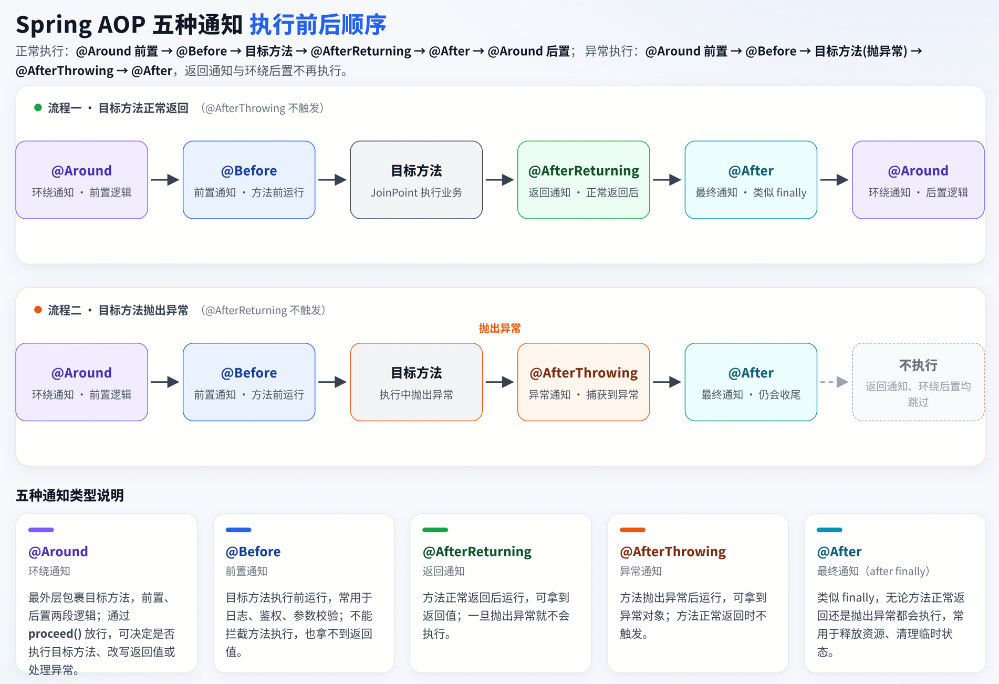

## 五种通知

Spring AOP提供五种通知类型，全部是通过注解声明的：

- @Before ：目标方法执行前执行。
- @After ：目标方法后执行，无论正常还是异常结束，都执行，类似 finally 。
- @AfterReturning ：目标方法正常返回后执行。
- @AfterThrowing ：目标方法抛出异常后执行。
- @Around ：包裹目标方法，可控制目标方法是否执行、参数和返回值替换，是最灵活的通知。属于`最外层`的执行。

## 执行顺序



- **正常返回**：`@Around 前置` → `@Before` → 目标方法 → `@AfterReturning` → `@After` → `@Around 后置`。
- **抛出异常**：`@Around 前置` → `@Before` → 目标方法 (抛异常) → `@AfterThrowing` → `@After`；此时 `@AfterReturning` 与
  `@Around 后置` 被跳过。

## 单AOP

### 接口

```java
package com.tothefor.study.proxy;

public interface DemoInterface {
    int add(int a, int b);

    void show(String id);
}

```

### 实现类

```java
package com.tothefor.study.proxy;

import org.springframework.stereotype.Component;
import org.springframework.stereotype.Service;

@Service
public class DemoInterfaceImpl implements DemoInterface {

    @Override
    public int add(int a, int b) {
        System.out.println("开始计算");
//        int i = 1/0;
        return a + b;
    }

    @Override
    public void show(String id) {
        System.out.println("输出结果为：" + id);
    }
}

```

### AOP

```java
package com.tothefor.study.proxy;


import org.aspectj.lang.ProceedingJoinPoint;
import org.aspectj.lang.annotation.*;
import org.springframework.core.annotation.Order;
import org.springframework.stereotype.Component;

@Component
@Aspect
@Order(1)
public class DemoAOP {

    @Pointcut("execution(* com.tothefor.study.proxy.DemoInterface.*(..))")
    public void points() {

    }


    @Before("points()")
    public void before() {
        System.out.println("before");
    }

    @After("points()")
    public void after() {
        System.out.println("after");
    }

    @AfterThrowing("points()")
    public void afterThrowing() {
        System.out.println("afterThrowing");
    }

    @AfterReturning("points()")
    public void afterReturning() {
        System.out.println("afterReturning");
    }

    @Around("points()")
    public Object around(ProceedingJoinPoint proceedingJoinPoint) throws Throwable {
        System.out.println("around before");
        Object proceed = proceedingJoinPoint.proceed();
        System.out.println("around after");
        return proceed;
    }
}

```

### 测试

```java
package com.tothefor.study;

import com.tothefor.study.proxy.DemoInterface;
import org.junit.jupiter.api.Test;
import org.springframework.boot.test.context.SpringBootTest;

import javax.annotation.Resource;

@SpringBootTest
class StudyApplicationTests {

    @Resource
    private DemoInterface demoInterface;

    @Test
    void contextLoads() {
        demoInterface.add(1, 2);
    }

}

```

### 正常输出

```bash
around before
before
开始计算
afterReturning
after
around after
```

### 异常输出

```bash
around before
before
开始计算
afterThrowing
after

java.lang.ArithmeticException: / by zero
```

## 多AOP

### 新增AOP

直接复制一个刚才的调整一下：

```java
package com.tothefor.study.proxy;


import org.aspectj.lang.ProceedingJoinPoint;
import org.aspectj.lang.annotation.*;
import org.springframework.core.annotation.Order;
import org.springframework.stereotype.Component;

@Component
@Aspect
@Order(2)
public class DemoAOP2 {

    @Pointcut("execution(* com.tothefor.study.proxy.DemoInterface.*(..))")
    public void points() {

    }


    @Before("points()")
    public void before() {
        System.out.println("2 before");
    }

    @After("points()")
    public void after() {
        System.out.println("2 after");
    }

    @AfterThrowing("points()")
    public void afterThrowing() {
        System.out.println("2 afterThrowing");
    }

    @AfterReturning("points()")
    public void afterReturning() {
        System.out.println("2 afterReturning");
    }

    @Around("points()")
    public Object around(ProceedingJoinPoint proceedingJoinPoint) throws Throwable {
        System.out.println("2 around before");
        Object proceed = proceedingJoinPoint.proceed();
        System.out.println("2 around after");
        return proceed;
    }
}

```

### 正常输出

```bash
around before
before
2 around before
2 before
开始计算
2 afterReturning
2 after
2 around after
afterReturning
after
around after
```

### 异常输出

```bash
around before
before
2 around before
2 before
开始计算
2 afterThrowing
2 after
afterThrowing
after

java.lang.ArithmeticException: / by zero
```

## 扩展

### JoinPoint

`@Around`方法中添加了一个`ProceedingJoinPoint`类型的参数。除此之外，其他的注解方法中也可以加一个`JoinPoint`
类型的参数，但`必须放到第一个位置`，可以通过它获取方法的参数。如下所示：

```java

@Before("points()")
public void before(JoinPoint joinPoint) {
    System.out.println("before：" + Arrays.toString(joinPoint.getArgs()));
}

@After("points()")
public void after(JoinPoint joinPoint) {
    System.out.println("after" + Arrays.toString(joinPoint.getArgs()));
}

@AfterThrowing(value = "points()")
public void afterThrowing(JoinPoint joinPoint) {
    System.out.println("afterThrowing：" + Arrays.toString(joinPoint.getArgs()));
}

@AfterReturning(value = "points()")
public void afterReturning(JoinPoint joinPoint) {
    System.out.println("afterReturning：" + Arrays.toString(joinPoint.getArgs()));
}
```

### AfterReturning

可以在`@AfterReturning`对应的方法内拿到方法最后返回的结果。如下所示：

```java

@AfterReturning(value = "points()", returning = "res")
public void afterReturning(Object res) {
    System.out.println("afterReturning：" + res);
}
```

- 注解里面的参数名称必须和方法里的参数名称保持一致！！！

### AfterThrowing

可以指定抛出异常的类型，如果与指定的异常不匹配，则不会触发对应的AOP方法。如下所示：

```java

@AfterThrowing(value = "points()", throwing = "ex")
public void afterThrowing(NullPointerException ex) {
    System.out.println("afterThrowing：" + ex.getMessage());
}
```

- 指定了异常类型为`NullPointerException`，所以，在上面的示例中，如果抛出的依旧是`java.lang.ArithmeticException: / by
  zero`，那么该方法是不会执行的。
